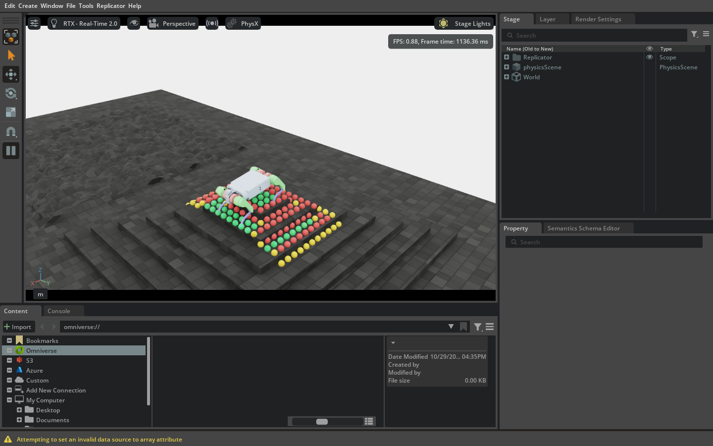
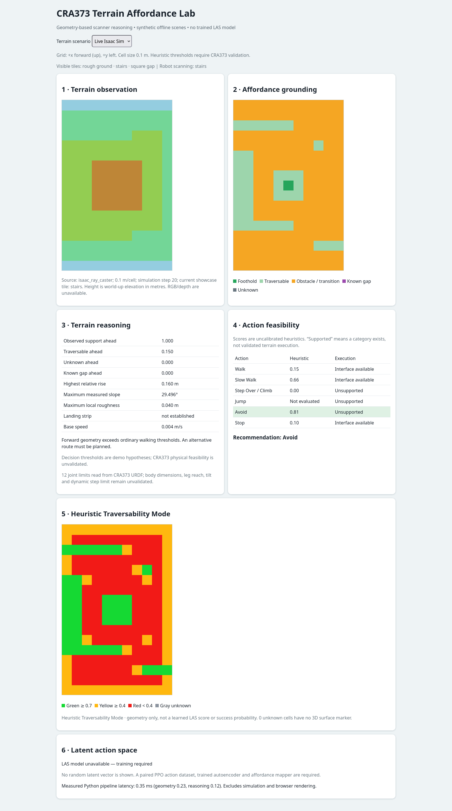
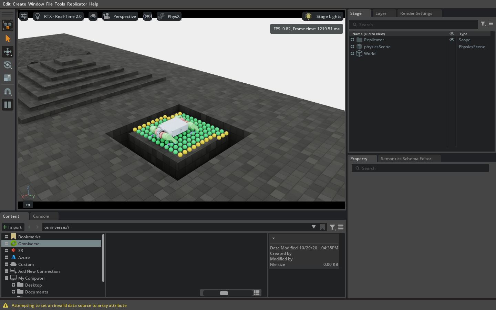
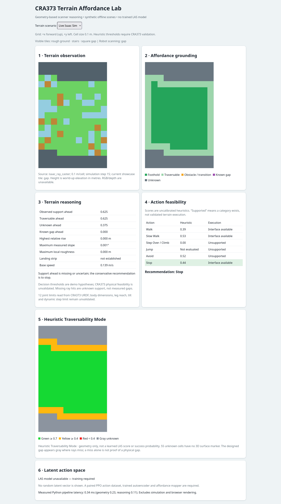
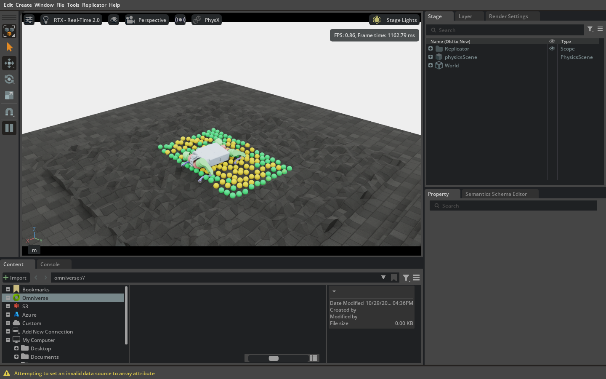
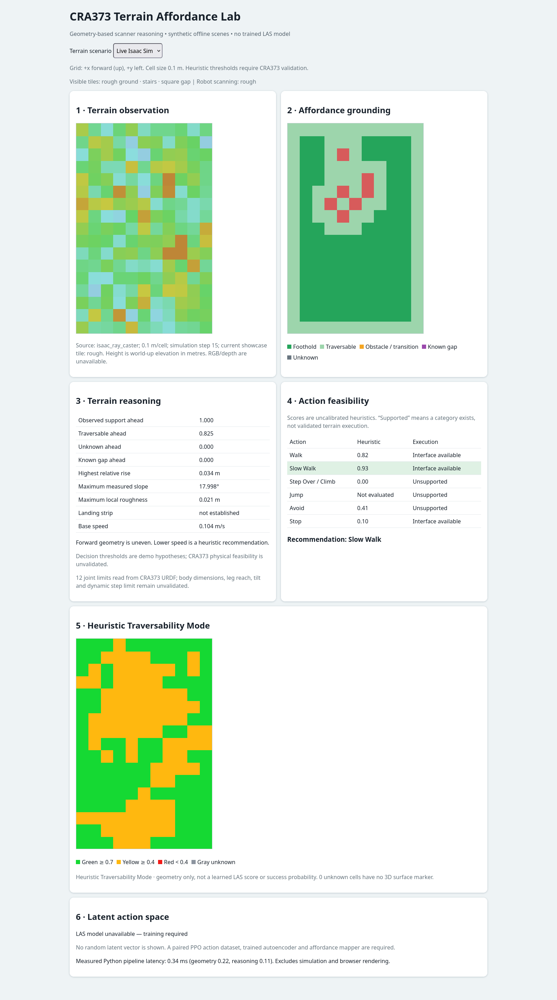

# CRA373 地形可供性與潛在動作空間研究展示

本資料夾是從原始 `CRA373_final` 完整複製的獨立專案。機器人模型、PPO 訓練程式、設定檔與既有檢查點均保留於此；原始專案未因本展示而修改。

## 專案目標

本展示連結 **Isaac Sim 中的 CRA373 與地形**，以及**另一個瀏覽器視窗中的即時分析面板**。系統使用機器人上的高度掃描器，計算局部地形高度、坡度、粗糙度與高度變化，再推估可通行區、可能落腳點和風險區域，最後提出可解釋的行動建議。

目前實作的是**依據幾何資料的可供性推估與規則推理**。它沒有從 RGB 影像學習地形材質，也沒有訓練完成的潛在動作空間（LAS）模型。行動分數是未校準的啟發式數值，不代表成功機率。

## 同時開啟 Isaac Sim 與即時面板

在本資料夾中執行：

```bash
/home/dog101/miniconda3/envs/env_isaaclab_2/bin/python scripts/rsl_rl/live_affordance.py
```

程式會開啟 Isaac Sim Kit 視窗，載入 **CRA373-Rough-v0**。預設展示固定的三塊相鄰地形：**隨機粗糙地、金字塔階梯、方形環狀缺口**。鏡頭同時俯視三塊地形；機器人先掃描階梯，約每 6 秒重新定位至缺口、粗糙地，再回到階梯。這是展示用的場景切換，不代表機器人能自行跨越缺口。Isaac Sim 視窗會在掃描到的地形上疊加即時可通行性彩色點；程式也會開啟另一個瀏覽器視窗：

```text
http://127.0.0.1:7860/?mode=live
```

瀏覽器約每 0.5 秒取得最新的模擬資料，並以相同綠／黃／紅／灰分類顯示即時可通行性格網。若瀏覽器沒有自動開啟，請手動輸入上述網址。關閉 Isaac Sim 視窗會結束即時面板服務。

可選參數：`--no-browser` 不自動開啟瀏覽器；`--dashboard-port 8765` 變更服務埠；`--frames 500` 執行固定步數後結束。若預設的 7860 埠已被使用，程式會在啟動 Isaac Sim 前選用後續可用埠並印出實際面板網址；`--dashboard-port 0` 可讓系統自動選埠。

### 切換地形與視角

```bash
# 預設：三塊地形輪流掃描，Isaac Sim 顯示全景
/home/dog101/miniconda3/envs/env_isaaclab_2/bin/python scripts/rsl_rl/live_affordance.py

# 固定觀察缺口，鏡頭近距離跟隨機器人；不自動換地形
/home/dog101/miniconda3/envs/env_isaaclab_2/bin/python scripts/rsl_rl/live_affordance.py --terrain-focus gap --showcase-cycle-seconds 0 --showcase-camera follow --control neutral

# 還原先前只有隨機粗糙地的展示
/home/dog101/miniconda3/envs/env_isaaclab_2/bin/python scripts/rsl_rl/live_affordance.py --terrain-scene rough
```

`--terrain-focus rough|stairs|gap` 指定起始掃描區；`--showcase-cycle-seconds 0` 停止自動切換；`--showcase-camera overview|follow` 切換全景與近景。瀏覽器標明機器人當下掃描的區塊。方形缺口沒有地表，RayCaster 在其中可能無回波：**灰色代表未知**，不把單次無回波偽稱為已證實的缺口。缺口邊緣有實際命中的格子會因相鄰未知區而降為黃色條件式通行。

### Isaac Sim 視窗中的可通行性彩色點

彩色點直接疊在 **RayCaster 真正命中的世界座標**上，預設抬高 2.5 公分以免被地形遮住。每 0.1 秒更新一次，會跟隨機器人位置與朝向變動；使用 Isaac Lab 的單一 `PointInstancer` 重用點標記，不會逐格建立新的場景物件，且沒有碰撞體。

| 顏色 | 幾何啟發式判讀 |
| --- | --- |
| 綠色 | 分數 ≥ 0.7：目前幾何門檻內的可通行候選區 |
| 黃色 | 0.4 ≤ 分數 < 0.7：條件式通行，需要謹慎評估 |
| 紅色 | 分數 < 0.4：明顯超出門檻的高風險區；已確認無支撐的格子也屬紅色 |
| 灰色 | 未知：沒有可信的地面命中點，因此不在 3D 地形上捏造灰色位置；面板格網仍顯示未知 |

分數採 `clip(1 − 0.5 × 最大正規化幾何風險, 0, 1)`。風險使用坡度、局部粗糙度、高度不連續與障礙高度，並以 `CapabilityHypotheses` 的**未驗證**門檻正規化。它只是展示用的「Heuristic Traversability Mode」，**不是**訓練後的 LAS 預測，也**不是**通過成功率。彩色點不控制機器人。

```bash
# 不顯示 3D 點，但仍保留面板分析
/home/dog101/miniconda3/envs/env_isaaclab_2/bin/python scripts/rsl_rl/live_affordance.py --no-traversability-viz

# 調整更新率、點大小及顯示距離
/home/dog101/miniconda3/envs/env_isaaclab_2/bin/python scripts/rsl_rl/live_affordance.py --viz-update-hz 5 --viz-point-radius-m 0.04 --viz-max-distance-m 2
```

可再用 `--viz-opacity`、`--viz-green-threshold`、`--viz-yellow-threshold`、`--viz-sample-stride`（每 N 列／欄取 1 個點） 調整透明度與顏色門檻。`--headless` 會自動關閉 3D 點的建立，但仍計算並發布瀏覽器面板；不需要訓練或修改 PPO。

### 面板內容

1. **地形觀測**：以機器人為中心的 17 × 11 高度格網，每格 0.1 公尺。
2. **地形可供性**：標示可通行區、可能落腳點、障礙與高度變化；無回波位置標為「未知」，不直接判定為缺口。
3. **地形推理**：顯示可觀測比例、相對高度、坡度、粗糙度及判斷依據。
4. **行動可行性**：列出步行、慢走、跨越／攀爬、跳躍、繞行及停止的啟發式評分與建議。
5. **即時可通行性**：顯示與 Isaac Sim 彩色點同步的分類格網、圖例及啟發式模式標籤。
6. **潛在動作空間**：目前清楚標示模型尚未訓練，不顯示虛構的潛在向量。

即時模式讀取同一個模擬步的掃描器命中點、機器人位置、朝向與速度。**面板的建議不會送回機器人關節。**即時展示預設載入複製專案中現有的平地 PPO `model_4200.pt`。程式只取粗糙地形觀測中與平地訓練相同的 48 個輸入，送進原有 actor 並執行其 12 維動作；此為**未驗證的平地策略跨地形測試**，不代表它已學會粗糙地形行走。可用 `--control neutral` 切換為零關節偏移命令，或用 `--checkpoint 路徑` 指定另一個相容的 48 輸入平地檢查點。

## 不開啟 Isaac Sim 的離線展示

```bash
python -m cra373.demo.demo_offline --output demo_results
python -m cra373.demo.demo_app --port 7860
```

離線模式提供四種固定的**合成**案例：平地、粗糙地形、凸起台階、已知缺口。案例僅用於展示與回歸檢查，不是實際掃描資料。執行後會在 `demo_results/` 產生 JSON、PNG 與 `summary.csv`；瀏覽器可切換各案例。離線模式需要 NumPy、Matplotlib；即時模式另需已安裝的 Isaac Lab、Isaac Sim 與 PyTorch 環境。

## 程式位置

| 路徑 | 用途 |
| --- | --- |
| `scripts/rsl_rl/live_affordance.py` | 啟動 Isaac Sim、切換展示地形、讀取即時掃描資料並提供面板 |
| `cra373/demo/showcase_terrain.py` | 固定產生粗糙地、階梯、缺口三塊相鄰地形並選擇掃描區 |
| `cra373/affordance/terrain_observation.py` | 世界座標掃描點轉換成機器人朝向座標的高度格網 |
| `cra373/affordance/terrain_affordance.py` | 計算幾何特徵與空間可供性遮罩 |
| `cra373/affordance/traversability_viz.py` | 將幾何特徵轉為可通行性分數、顏色與世界座標點 |
| `cra373/demo/viewport_traversability.py` | Isaac Lab `PointInstancer` 彩色點視覺化 |
| `cra373/demo/flat_policy.py` | 讀取現有平地 PPO actor，將粗糙地形觀測取出相同的 48 個輸入 |
| `cra373/affordance/affordance_reasoner.py` | 產生行動評分、建議與可追溯的說明 |
| `cra373/demo/` | 瀏覽器介面、固定案例與離線匯出 |
| `tests/test_affordance_demo.py`、`tests/test_traversability_viz.py` | 座標轉換、顏色、缺口語義與世界座標等測試 |
| `AFFORDANCE_LAS.md` | 英文技術分析、研究限制與後續 LAS 計畫 |
| `docs/CRA373_地形可供性技術說明.md`、`.docx` | 繁體中文技術資料報告：架構、資料格式、判讀依據與驗證 |

## 驗證與研究限制

執行測試：

```bash
python -m unittest discover -s tests -v
```

地形判斷門檻目前是**待驗證的展示假設**，並非 CRA373 已量測的最大跨越高度或安全坡度。跨越、跳躍與繞行尚未接上經驗證的控制器或路徑規劃器。LAS 的下一階段需要從現有 PPO 收集時間對齊的動作序列，訓練動作自編碼器與可供性到潛在向量的映射，再以保留地形測試重建誤差；完成離線驗證前不會執行解碼動作。

## 三種地形的實際展示畫面

以下畫面均在本獨立專案中以 `--control neutral --showcase-cycle-seconds 0` 固定掃描區擷取。左側是 Isaac Sim 真實地形與機器狗，右側是同一次執行的即時網頁資料快照；快照保留第 1 至第 6 個標題的完整內容。全景可另看[三塊地形的相對位置](validation/showcase_gap_viewport_final.png)。可點開圖片看原始解析度；畫面、單步 JSON 與可離線開啟的網頁快照保存在 `validation/report_*`。

### 階梯（stairs）





掃描 187/187 格有命中；可通行性分類為綠 39、黃 50、紅 98、灰 0。階梯高度與邊緣造成紅色區域，規則建議 **Avoid（迴避）**；這是提示，不是已執行的繞路控制。

### 方形缺口（gap）





掃描 132/187 格有命中，55 格無命中並標灰；其餘為綠 108、黃 24。中心平台有實際地面命中，缺口環周圍沒有可信地面位置，因此 3D 視窗不繪製灰點。單次 RayCaster 無回波只表示**未知支撐**，不等於感測器已證實缺口。前方未知比例 0.375，規則建議 **Stop（停止）**；這項建議沒有送入機器狗控制器。

### 隨機粗糙地（rough）





掃描 187/187 格有命中；可通行性分類為綠 99、黃 88、紅 0、灰 0。局部高度與坡度變動使部分區域由綠轉黃，規則建議 **Slow Walk（慢行）**；安全速度尚未校準。

### 網頁六個標題顯示什麼

| 標題（網頁原文） | 顯示內容與解讀 |
| --- | --- |
| **1 · Terrain observation** | 17 × 11 格的相對掃描視野，顏色表示世界座標高度；灰色是無有效命中的格子。圖上方為機器狗前方，格距 0.1 m。下方列出資料來源、模擬步與目前掃描地形。 |
| **2 · Affordance grounding** | 將幾何特徵映射為候選落腳點、可通行、障礙／地形轉折、已知缺口、未知等遮罩。即時缺口畫面的無回波是灰色未知；紫色「已知缺口」只適用於明確提供地形真值的離線合成案例。 |
| **3 · Terrain reasoning** | 前方觀測比例、可通行比例、未知比例、相對凸起高度、最大坡度、粗糙度、著地條件與機身速度；文字說明判斷依據、資訊不足與尚未量測的機器能力。 |
| **4 · Action feasibility** | Walk、Slow Walk、Step Over / Climb、Jump、Avoid、Stop 六類的啟發式分數／是否有執行介面，以及醒目的建議。分數不是成功機率；「Interface available」不等於已完成地形驗證。 |
| **5 · Heuristic Traversability Mode** | 與 Isaac Sim 點標記共用的綠／黃／紅分類，以及網頁另顯示的灰色未知格。門檻分別為綠 ≥ 0.7、黃 ≥ 0.4、紅 < 0.4；這是未校準的幾何風險分數。 |
| **6 · Latent action space** | 明示 `LAS model unavailable — training required`、不顯示虛構的潛在向量；另列 Python 幾何與推理模組處理時間，**不含**模擬與瀏覽器繪製時間。 |

需要重現固定地形時，執行 `--terrain-focus stairs|gap|rough --showcase-cycle-seconds 0 --showcase-camera follow --control neutral`。網頁正常模式每約 0.5 秒更新；供文件擷取的 `/?mode=live&snapshot=1` 只讀取當下已發布的一個模擬步，之後不再自動刷新。詳細資料結構、演算法與 LAS 待完成項目見[繁體中文技術說明](docs/CRA373_地形可供性技術說明.md)。
