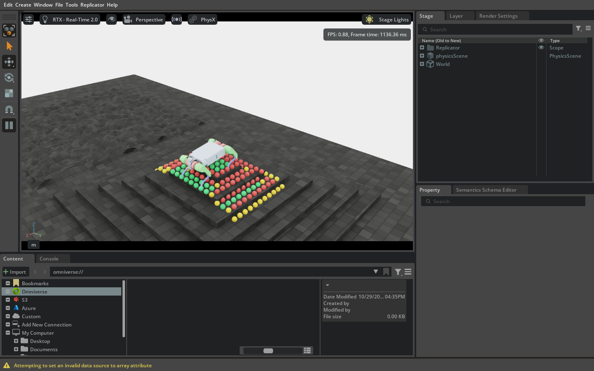
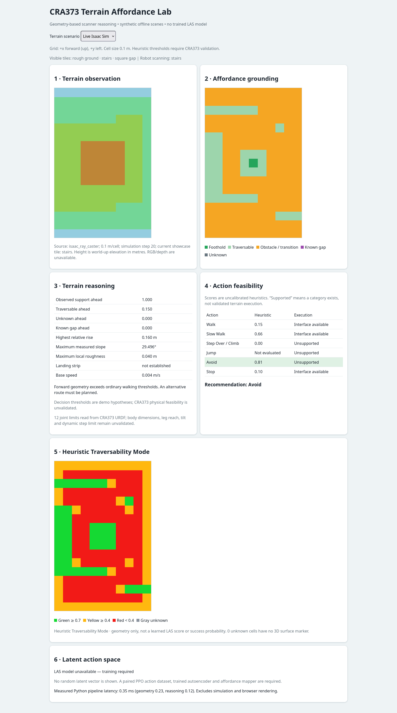
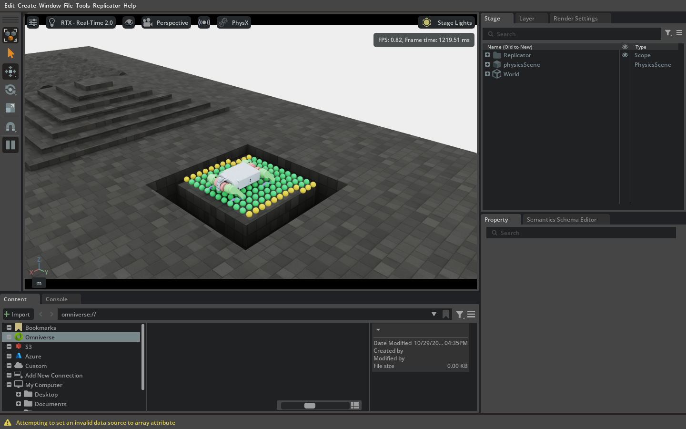
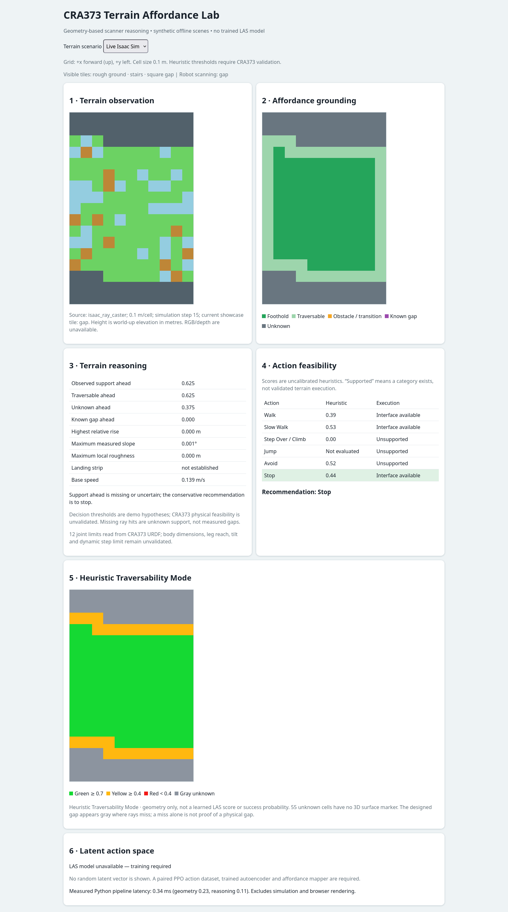
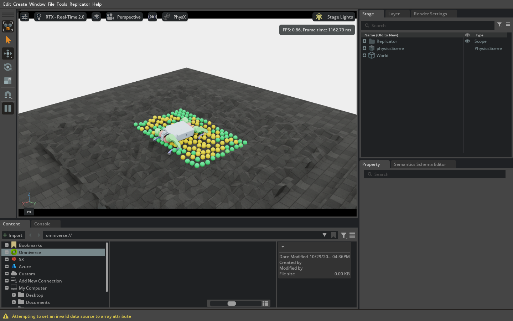
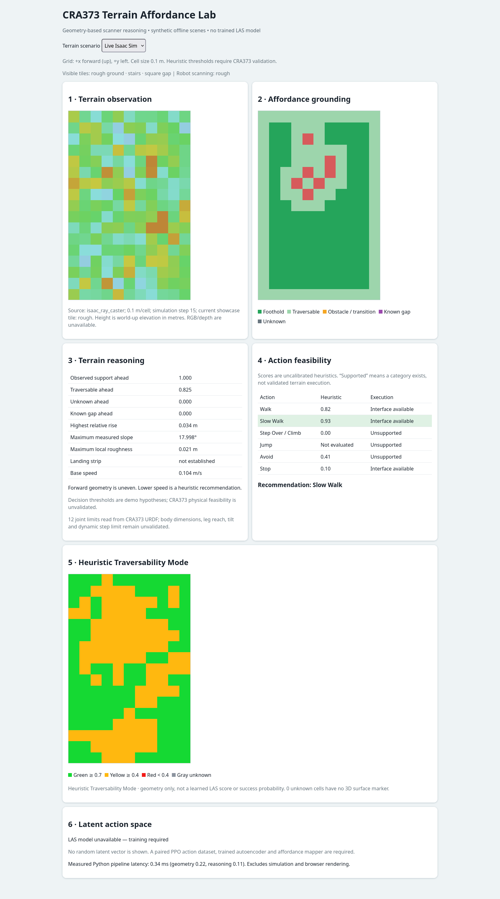

# CRA373 視覺化地形可供性與潛在動作空間技術說明

**技術資料報告｜版本 1.0｜2026-10-29**  
**適用專案：** `CRA373_Affordance_LAS`（由 `CRA373_final` 完整複製的獨立工作目錄）  
**目前狀態：** 即時幾何可供性展示可執行；LAS 模型尚未訓練、尚未接入控制迴路。

## 摘要

本報告定義 CRA373 四足機器人在 Isaac Lab／Isaac Sim 地形展示中的資料流、座標與陣列格式、幾何可供性演算法、可通行性視覺化、網頁六個區塊與控制邊界。展示場景包含粗糙地、金字塔階梯及方形環狀缺口。系統從 `height_scanner` 的**原始世界座標 RayCaster 命中點**建立機器人朝向對齊的 17 × 11 高度格網，計算坡度、粗糙度、高度不連續、候選落腳點與啟發式風險，並將同一模擬步的結果顯示在 Isaac Sim 彩色點及本機網頁。既有平地 PPO actor 可作為展示時的關節命令來源；網頁的行動建議不進入關節命令。報告中所有幾何門檻均為待驗證假設，分數不是成功機率，無回波不是已證實缺口。

參考的 `.doc` 文件提供了「封面／摘要／技術架構／資料格式與定義／圖表／驗證」的撰寫格式。本報告描述**目前 CRA373 實作**；參考文件中的 RGB-D 操作物件、HAMMER、KL-VAE、LaWAM、32 維潛在向量與效能數字，均**不是本專案已實作或已驗證的結果**。本報告未沿用參考文件的機密等級標示或研究數據。

## 1. 範圍、術語與實作狀態

| 名詞 | 本專案中的定義 | 現況 |
| --- | --- | --- |
| 地形觀測 | RayCaster 命中點彙整為機器人朝向座標的高度格網 | 已實作，含未知遮罩 |
| 可供性 grounding | 將格網幾何轉為可通行、障礙、候選落腳點等空間遮罩 | 已實作，規則式 |
| 行動可行性推理 | 用前方地形特徵產生 Walk／Slow Walk／Step Over／Jump／Avoid／Stop 的分數與說明 | 已實作，啟發式；不執行建議 |
| 可通行性彩色點 | 將有實際地面命中的格子以綠／黃／紅點放回世界座標 | 已實作；未知格不繪製假地面 |
| LAS（Latent Action Space） | 從時間對齊的機器人動作序列學得潛在表示，再由地形可供性預測可執行潛在動作 | **尚未納入即時系統**：無訓練後 encoder／mapper／decoder，也無 LAS checkpoint |
| 控制器 | 將觀測轉成 12 維關節偏移的既有平地 PPO actor，或全零 neutral 命令 | 展示可執行；跨地形成功率未驗證 |

**邊界：** 本系統使用高度掃描幾何，沒有 RGB 影像語意模型，也沒有從圖片直接學到材質或可供性。`known_gap` 僅由離線合成案例的真值提供；即時缺口周邊的無回波仍標為未知。Step Over／Jump／Avoid 尚未接上已驗證的專用控制器或路徑規劃器。

## 2. 整體技術架構

```text
Isaac Lab：CRA373-Rough-v0，單一 CRA373，三塊展示地形
  ├─ height_scanner：世界座標 RayCaster 命中點 [N,3]
  ├─ robot：根部位置、xyzw 四元數、機身速度
  └─ 235 維 rough policy observation ──取前 36 + 後 12──> 48 維平地 PPO actor ──> 12 維關節命令
                       │
                       └─ 注意：下方推理結果不送入此控制路徑

原始命中點 + 機器人狀態
  → TerrainObservation（17×11，0.1 m/格，含 valid 與實測世界座標）
  → AffordanceMap（高度、坡度、粗糙度、遮罩）
  ├─ AffordanceReasoningResult（前方統計、六類行動分數、文字說明）
  └─ MarkerFrame（綠／黃／紅／灰、分數、真實命中點）
       ├─ Isaac Sim PointInstancer：只繪製有效命中點
       └─ /api/live：同一模擬步 JSON → 網頁六個區塊
```

入口為 `scripts/rsl_rl/live_affordance.py`。它在 AppLauncher 前預留本機 HTTP 埠，啟動 Kit、建立 `CRA373-Rough-v0` 環境，設定展示地形與相機，讀取 scanner／robot 狀態，呼叫幾何分析，發布 JSON，並更新 3D 標記。`cra373/demo/demo_app.py` 的 `ThreadingHTTPServer` 提供 `/api/live` 與頁面；瀏覽器正常模式約每 500 ms 讀取一次。模擬設定 `dt=1/200 s`、`decimation=4`，因此一個策略步約 0.02 s；預設每 5 步發布面板資料，可通行性標記目標更新率為 10 Hz。實際畫面更新率受 Kit 渲染與硬體影響。

### 2.1 展示地形與切換

`cra373/demo/showcase_terrain.py` 將原 rough 環境的 terrain generator 配成固定 1 列 × 3 欄，每塊 4 × 4 m，seed 373。三欄依序為：

| 欄 | 生成器與主要參數 | 展示目的 |
| --- | --- | --- |
| rough | random rough；噪聲範圍 0.03–0.09 m、步進 0.02 m | 比較局部粗糙度、黃／綠格 |
| stairs | pyramid stairs；階高 0.08 m、階寬 0.25 m、中央平台 1.0 m | 觀察階梯邊緣、高度不連續與紅格 |
| gap | MeshGapTerrain；缺口寬 0.28 m、中央平台 1.2 m | 觀察無回波、灰色未知與保守停止建議 |

預設先掃描 stairs，每 6 **模擬秒**透過修改展示環境的地形原點並呼叫 `env.reset()` 切到 gap、rough，再返回 stairs。此為展示用重新定位，**不代表機器人走過階梯或跨越缺口**。`--showcase-cycle-seconds 0` 可固定地形；`--showcase-camera follow` 讓相機跟隨機器狗。`--terrain-scene rough` 可切回原本的全粗糙地展示。

## 3. 資料座標、格式與定義

### 3.1 座標轉換

Isaac Lab scanner 給出世界座標命中點 `p_w=(x_w,y_w,z_w)`。令機器人根部世界座標 `b_w`、從 `xyzw` 四元數取得的 yaw 為 ψ；以僅繞世界 z 軸旋轉的矩陣，將水平差 `p_w.xy-b_w.xy` 投到機器人前方 `+x_b`、左方 `+y_b`。高度保留世界向上 `z_w`，**不以機器人 roll／pitch 旋轉高度軸**，使坡度仍相對重力有意義。格網索引為 `round(x_b/0.1+8)`、`round(y_b/0.1+5)`；超出 17 × 11 的命中點捨棄。同格多個命中以 z 中位數代表高度，3D 標記保留其中一個**實際量測**的世界座標點。

### 3.2 主要物件與 JSON 欄位

| 欄位／物件 | 型別與形狀 | 單位與語義 | 無效值處理 |
| --- | --- | --- | --- |
| `ray_hits_w_m` | `float[N,3]`，scanner 原始命中 | 世界座標 x、y、z，m | 非有限命中不進格網 |
| `height_m` | `float[17,11]`；JSON `number|null` | 世界向上 z 高度，m | 無命中為 NaN；JSON 轉 `null` |
| `valid` | `bool[17,11]`；JSON `0|1` | 是否有可靠有限命中與實測 XYZ | 無命中為 false |
| `hit_points_w_m` | `float[17,11,3]` | 每格保留一個實測世界座標點，供 3D 點標記 | 無命中為 NaN，不繪製 |
| `known_unsupported` | `bool[17,11]` | 明確提供「無支撐」真值的離線案例 | 即時資料全 false |
| `resolution_m` | `float` | 每格 0.1 m | 必須為有限正值 |
| `base_position_w_m` | `float[3]` | 機器人根部世界座標，m | 取當步 robot state |
| `base_yaw_rad` | `float` | 機器人水平朝向，rad | 由 xyzw 四元數求得 |
| `base_velocity_b_mps` | `float[3]` | 機身座標線速度，m/s | 取當步 robot state |
| `timestamp_s` | `float` | 即時模式為模擬時間 | 與 `live_step` 同一資料快照 |
| `metadata` | `object` | 含 `frame`、`input_hits`、`live_step`、`terrain_scene`、`terrain_feature` | 用以對照畫面與地形 |
| `maps` | 多個 `0|1[17,11]` | 可通行、候選落腳點、障礙、轉折、缺口、未知等遮罩 | 依欄位語義為 0 或 1 |
| `traversability.categories` | `int[17,11]` | `0=綠`、`1=黃`、`2=紅`、`3=灰` | 灰色代表未知 |
| `traversability.scores` | `number|null[17,11]` | 幾何啟發式分數 0–1，非成功機率 | 未知為 `null` |
| `reasoning` | `object` | 前方統計、六類行動、選定建議、說明、限制 | 未評估分數為 `null` |
| `las` | `object` | `status`、`latent_vector`、`reconstruction_mse` | 目前後兩欄均為 `null` |
| `latency_ms` | `object` | Python affordance／reasoning／total 計算毫秒數 | 不含模擬、傳輸、網頁繪製 |

`coordinate_frame` 固定為 `base_yaw_aligned_world_up`。格網 row 增加代表前方、column 增加代表左側；網頁以 row 倒序繪製，使前方位於圖片上方。相同模擬步的 `height_m`、`maps`、`reasoning`、`traversability` 由一次發布的完整 JSON 交付；HTTP 回應以 lock 讀取完整快照，避免半更新資料。

### 3.3 回應格式範例（節錄）

```json
{
  "source": "isaac_ray_caster",
  "coordinate_frame": "base_yaw_aligned_world_up",
  "resolution_m": 0.1,
  "metadata": {"live_step": 15, "terrain_scene": "showcase", "terrain_feature": "gap"},
  "height_m": "17x11 number|null array",
  "valid": "17x11 0|1 array",
  "maps": {"traversable": "17x11 0|1 array", "unknown": "17x11 0|1 array"},
  "reasoning": {"selected_action": "Stop", "features": {"ahead_unknown_fraction": 0.375}},
  "traversability": {"mode": "Heuristic Traversability Mode", "categories": "17x11 0..3 array"},
  "las": {"status": "LAS model unavailable — training required", "latent_vector": null, "reconstruction_mse": null}
}
```

字串 `"17x11 ... array"` 僅為此文件縮寫；實際 `/api/live` 會送出完整陣列。實際 gap 畫面的原始快照見 `validation/report_gap_snapshot.json`。

## 4. 幾何可供性與可通行性演算法

### 4.1 特徵與遮罩

`estimate_affordance` 以後方三分之一的有效格之高度中位數作基準高度（若後方全無命中，則用所有有效格）。每格的相對高度為 `height_m - baseline`。坡度以 x／y 方向中心差分計算，`slope_deg = degrees(atan(hypot(dh/dx,dh/dy)))`；3 × 3 鄰域的高度標準差為粗糙度，最大值減最小值為高度不連續。主要展示門檻為：一般台階 0.06 m、候選台階 0.18 m、最大坡度 15°、粗糙度 0.035 m、高度不連續 0.07 m、著地長度 0.20 m。這些數值定義在 `CapabilityHypotheses`，**尚未經 CRA373 實體或跨地形模擬性能校準**。

有效命中且相對高度超過一般台階門檻、局部不連續超過門檻的格子標為 obstacle；不連續過門檻者標為 transition。`unknown = ~valid & ~known_unsupported`；`gap = known_unsupported`。即時展示沒有 ground-truth unsupported mask，所以缺口周邊無回波仍是 unknown。高風險遮罩包含未知、明確已知缺口、障礙、轉折、過陡與過粗糙；可通行格為有效且非高風險。候選落腳點另要求周圍一格沒有高風險。這些遮罩是**幾何候選**，不保證腳端可達或全身動力學可行。

### 4.2 彩色點分數與缺口語義

定義正規化幾何風險 `r` 為坡度／15°、粗糙度／0.035 m、不連續／0.07 m，以及障礙相對高度／0.18 m 的最大值，負值以 0 截斷。展示分數為 `s = clip(1 - 0.5r, 0, 1)`。若有效命中格與未知／已知缺口相鄰，令 `r ≥ 1`，使其最多為黃格。預設 `s ≥ 0.7` 綠、`0.4 ≤ s < 0.7` 黃、`s < 0.4` 紅；沒有有效命中的格子為灰。若將明確已知無支撐真值送入可通行性分類器，該格歸紅；離線網頁的可供性圖以紫色區分已知缺口。沒有實測地面點時，不會產生 3D 標記。

3D 點只取 `hit_points_w_m` 中有限且距離機器人不超過 5 m 的實測點，沿世界 z 抬高 0.025 m，預設半徑 0.035 m、透明度 0.78。Isaac Lab `VisualizationMarkers` 在 `/World/Visuals/CRA373_Traversability` 使用單一 PointInstancer 重用標記；球體無碰撞。網頁顯示所有格子的顏色，包括灰色未知；Isaac Sim 不為未知格虛構世界位置。分數僅供可解釋視覺化，**不能當成成功率、政策價值或 LAS 輸出**。

### 4.3 行動建議邏輯

前方區域定義為 `x_b > 0` 且 `|y_b| ≤ 0.20 m`。推理器在此區域計算有效支撐、可通行、未知及已知缺口比例，並擷取最高相對凸起、最大坡度、最大粗糙度、機身水平速度及候選著地區。六類行動的分數為顯式規則：Walk／Slow Walk 由前方比例組合；Step Over 在候選高度與著地條件成立時得固定候選分數；Jump 因沒有動態可行性模型而為 `null`；Avoid 與 Stop 隨風險與未知比例提高。若有已知缺口、未知比例 > 0.25 或前方有效比例 < 0.7，優先建議 Stop；其他條件再考慮 Step Over、Avoid、Slow Walk、Walk。**建議與分數只發布到面板，沒有導入 env.step 的 action。**

## 5. 控制路徑與 LAS 現況

目前的 rough 環境 policy observation 長度 235，其中高度掃描樣本位於既有平地觀測與末端前次動作之間。`flat_policy.py` 取前 36 維及末 12 維組成既有平地 actor 所需 48 維；actor 是 `48→512→256→128→12` 的 ELU MLP，載入複製專案內的 `model_4200.pt`。`--control neutral` 則送出 12 個零偏移。兩種模式都只用於展示，目前沒有階梯、缺口或跳躍專用已驗證 checkpoint；平地策略在粗糙／階梯／缺口上的移轉效果不能由彩色標記推定。

**LAS 尚未納入專案中的即時技術鏈。** `pipeline.py` 的 `las.status` 明示 `LAS model unavailable — training required`，`latent_vector` 與 `reconstruction_mse` 為 `null`。目前沒有已訓練的動作序列自編碼器、可供性到潛在動作映射器、動作解碼器、配對 rollout 資料與評估指標；也沒有 LAS 關節命令注入。未來若要實作，需先從 PPO 收集時間對齊的掃描格網、機器狀態、速度命令、12 維動作、地形 ID、碰撞／成功結果；依地形 seed／布局分割訓練與測試；訓練動作序列 encoder／decoder 及 affordance-to-latent mapper；量測重建誤差、latent 一致性、保留地形泛化與穩定性；最後才比較閉迴路控制。參考文件的 32 維向量格式只是該文件自己的研究設定，**不能直接宣稱為 CRA373 的 LAS 格式**。

## 6. 網頁六個標題與資料對照

| 網頁標題 | 後端欄位 | 讀圖重點 |
| --- | --- | --- |
| 1 · Terrain observation | `height_m`、`valid`、`source`、`metadata` | 17 × 11 世界高度格網；灰格為無命中；前方在上 |
| 2 · Affordance grounding | `maps` | 落腳點、可通行、障礙／轉折、已知缺口、未知遮罩；即時缺口無回波為未知 |
| 3 · Terrain reasoning | `reasoning.features`、`explanation`、`uncertainty`、`capability_constraints` | 前方統計與推理原因，包含未驗證物理能力提示 |
| 4 · Action feasibility | `reasoning.actions`、`selected_action` | 六類啟發式分數與建議；建議不控制機器狗 |
| 5 · Heuristic Traversability Mode | `traversability.categories`、`scores`、`unknown_without_surface_hit` | 與 Isaac Sim 3D 點同色的網頁格網；灰格無 3D 地表座標 |
| 6 · Latent action space | `las`、`latency_ms` | LAS 不可用狀態與 Python 模組計時；非端到端延遲 |

`/?mode=live` 持續輪詢。為製作可核對的技術文件，`/?mode=live&snapshot=1` 在伺服器端只讀取一次已發布 JSON，嵌入同一網頁 renderer，讓六個標題顯示**同一模擬步**。快照網址不改動模擬、不訓練模型，也不送控制指令。

## 7. 三種地形的實際結果與畫面

以下是固定地形、neutral 控制、GUI Kit 實際擷取的單步快照。分類順序為綠／黃／紅／灰；數值隨實際機器人姿態與採樣步可能變動，不能視為性能統計。

| 地形 | 模擬步 | 有效命中 | 分類（綠／黃／紅／灰） | 前方未知比例 | 建議 |
| --- | ---: | ---: | --- | ---: | --- |
| 階梯 | 20 | 187/187 | 39／50／98／0 | 0.000 | Avoid |
| 方形缺口 | 15 | 132/187 | 108／24／0／55 | 0.375 | Stop |
| 粗糙地 | 15 | 187/187 | 99／88／0／0 | 0.000 | Slow Walk |

### 圖 1｜階梯：Isaac Sim 與六區塊網頁





### 圖 2｜方形環狀缺口：Isaac Sim 與六區塊網頁





### 圖 3｜粗糙地：Isaac Sim 與六區塊網頁





畫面原始資料分別為 `validation/report_{stairs,gap,rough}_snapshot.json`。缺口截圖呈現的是**地形設計上的真實缺口**；分類器只有掃描回波資訊，故缺口周邊在即時 JSON 中為灰色未知，不推入離線案例的真值。

## 8. 驗證方法、結果與限制

在複製專案內執行 `python -m unittest discover -s tests -v`，目前 13 項測試通過，涵蓋觀測格式、座標轉換、可供性遮罩、缺口與未知語義、顏色門檻、世界座標點，以及行動推理。另完成 GUI 三地形切換及三個固定地形擷取；對應執行紀錄在 `validation/`。粗糙地原模式的 187/187 命中回歸也已檢查。複製前完整性與主要資產比較記錄見 `AFFORDANCE_LAS.md`；原 `CRA373_final` 的來源、設定、PPO checkpoint、模型資產與訓練腳本均未因本展示改動。

此驗證證明地形顯示、掃描資料流與面板一致性，**不證明**機器人能跨越缺口、完成跳躍、在階梯穩定行走，或 LAS 已經學得可執行技能。Python `latency_ms` 僅量測 `estimate_affordance` 與 `reason`，不包含 RayCaster、Kit 渲染、HTTP、瀏覽器繪圖或資料擷取時間；因此不得與參考文件中的 GPU forward latency、端到端延遲或 IoU 作直接比較。

## 9. 重現步驟與主要檔案

```bash
cd /home/dog101/CRA373_new/CRA373_Affordance_LAS
/home/dog101/miniconda3/envs/env_isaaclab_2/bin/python scripts/rsl_rl/live_affordance.py
```

程式開啟 Isaac Sim Kit，並輸出實際面板 URL（預設 `http://127.0.0.1:7860/?mode=live`；被占用時自動選其他埠）。固定觀察缺口：

```bash
/home/dog101/miniconda3/envs/env_isaaclab_2/bin/python scripts/rsl_rl/live_affordance.py --terrain-focus gap --showcase-cycle-seconds 0 --showcase-camera follow --control neutral
```

| 檔案 | 責任 |
| --- | --- |
| `scripts/rsl_rl/live_affordance.py` | Kit／環境啟動、資料擷取、PPO 或 neutral 控制、面板發布 |
| `cra373/demo/showcase_terrain.py` | 三塊地形的 Isaac Lab 參數與展示定位 |
| `cra373/affordance/terrain_observation.py` | RayCaster 世界點轉 17 × 11 格網 |
| `cra373/affordance/terrain_affordance.py` | 幾何特徵與空間遮罩 |
| `cra373/affordance/affordance_reasoner.py` | 前方統計、行動建議、限制說明 |
| `cra373/affordance/traversability_viz.py` | 分數、分類、標記點陣列 |
| `cra373/demo/viewport_traversability.py` | Isaac Sim PointInstancer 顯示 |
| `cra373/demo/flat_policy.py` | 235→48 觀測配置轉接與既有 PPO actor 讀取 |
| `cra373/demo/demo_app.py`、`index.html` | 本機 JSON API、六區塊網頁與單步快照 |

## 附錄 A｜判讀與研究續接原則

1. 若新地形有大量無命中，應先核對 RayCaster 原始資料、相機位置、地形碰撞與格網對齊；**不能直接把無回波標為已知缺口**。
2. 若要宣稱「可跨越／可跳躍」，需有相應控制器、離線與閉迴路成功率、跌倒與撞擊統計，並以保留地形測試。
3. 若要宣稱 LAS 已接入，需提供訓練資料 schema、模型 checkpoint、encoder／mapper／decoder 版本、重建及泛化指標，以及明確的控制路徑測試。現階段網頁第 6 區塊刻意保持不可用標示。
4. 本報告數值與截圖僅對應 2026-10-29 的獨立複製專案版本；修改門檻、地形參數或 checkpoint 後須重新擷取與驗證。
